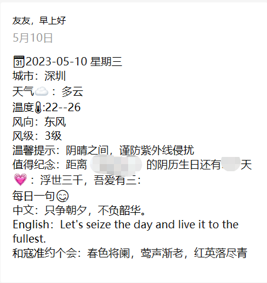

[📌返回首页](../../README.md)

# 常用的推送模板样例

## 注意事项

2023 年 5 月起，微信测试号的模板消息有以下限制：

- 不支持自定义颜色
- 单个字段超过 20 个字时会显示为省略号
- `{{xxx.DATA}}` 前面需要有文字或部分 emoji，否则该字段可能不显示，甚至影响后面的字段
- 不支持在字段内容中换行，多条生日或课程请使用 `wx_birthday_{index}`、`wx_course_schedule_{index}` 等带序号的参数

部分 emoji 无法正常显示，可以在 [Emojipedia](https://emojipedia.org) 中挑选后逐个测试。

## 每日推送

**样例1**

```text
🗓️{{date.DATA}}
城市：{{city.DATA}}
天气☁️：{{weather.DATA}}
温度🌡️: {{min_temperature.DATA}}--{{max_temperature.DATA}}
风向：{{wind_direction.DATA}}
风级：{{wind_scale.DATA}}
温馨提示：{{notice.DATA}}
值得纪念：{{wx_birthday_0.DATA}}
💗：{{earthy_love_words.DATA}}
每日一句😋
中文：{{note_ch.DATA}}
English：{{note_en.DATA}}
和{{poetry_author.DATA}}约个会：{{poetry_content.DATA}}
```



**样例2**

```text
🗓️{{date.DATA}}
今天是我们在一起的第{{love_day.DATA}}天，爱你❤️
今日{{city.DATA}}天气☁️：{{weather.DATA}}
温度🌡️: {{min_temperature.DATA}}-{{max_temperature.DATA}}
风向：{{wind_direction.DATA}}
风级：{{wind_scale.DATA}}
湿度：{{shidu.DATA}}
空气质量：{{aqi.DATA}}
预防感冒提醒：{{ganmao.DATA}}
下一休息日：{{holidaytts.DATA}}
下一个心动日：{{wx_birthday_0.DATA}}
```

**样例3**

```text
城市：{{city.DATA}}
天气：{{weather.DATA}}
最低气温：{{min_temperature.DATA}}
最高气温：{{max_temperature.DATA}}
今天是我们恋爱的第{{love_day.DATA}}天
今天是我们结婚的第{{marry_day.DATA}}天
生日提醒1：{{wx_birthday_0.DATA}}
生日提醒2：{{wx_birthday_1.DATA}}
生日提醒3：{{wx_birthday_2.DATA}}
第1节课：{{wx_course_schedule_0.DATA}}
第2节课：{{wx_course_schedule_1.DATA}}
第3节课：{{wx_course_schedule_2.DATA}}
第4节课：{{wx_course_schedule_3.DATA}}
```

`love_day`、`marry_day` 需要在用户的 `customizedDateList` 中配置，见 [配置说明](./config-demo.md#users-用户配置)。

## 推送完成提醒

```text
服务器时间：{{post_time.DATA}}
推送人数：{{need_post_num.DATA}}
成功人数：{{success_post_num.DATA}}
失败人数：{{fail_post_num.DATA}}
成功用户：{{success_post_ids.DATA}}
失败用户：{{fail_post_ids.DATA}}
```

[📌返回首页](../../README.md)
